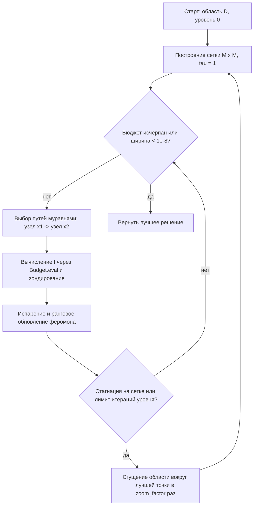
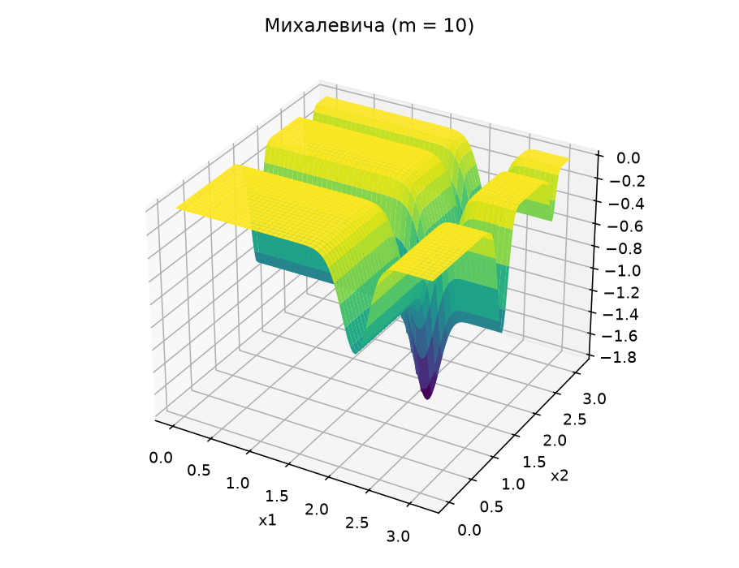
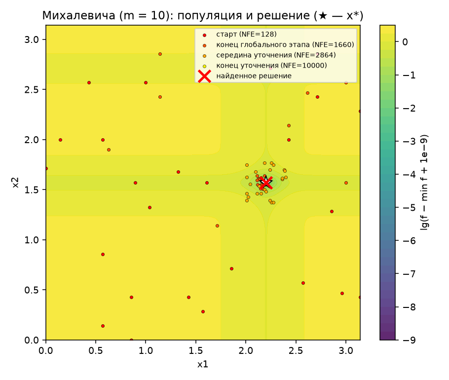
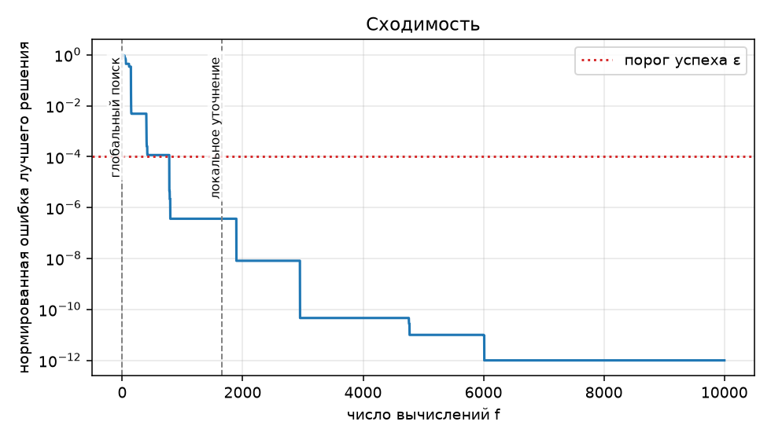
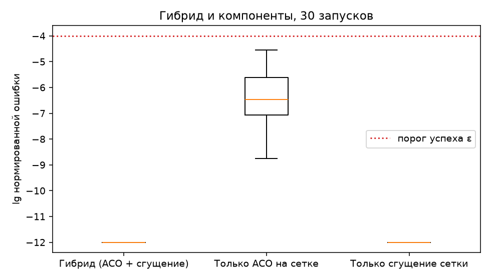

# Битва методов оптимизации: ACO на сетке + последовательное сгущение сетки

| | |
|---|---|
| Студент | Заботкина Марина Александровна |
| Группа / поток | K3339 / МетОпт 1.2 |
| Номер в списке потока | 10 |
| Преподаватель | Духанов Алексей Валентинович |
| Вариант | № 10  |
| Компоненты гибрида | ACO на сетке (дискретизация) + Последовательное сгущение сетки |
| Тестовая функция | Михалевича (m = 10), `--func michalewicz` |
| Код | [optimizer.py](optimizer.py), запуск — [run.py](run.py), рисунки — [demo.py](demo.py) |

## 1. Тестовая функция

Функция Михалевича (при параметре крутизны $m = 10$):

$$f(x_1, x_2) = -\sin(x_1)\sin^{20}\!\left(\frac{x_1^2}{\pi}\right) - \sin(x_2)\sin^{20}\!\left(\frac{2x_2^2}{\pi}\right)$$

| Область $D$ | $f^*$ | $x^*$ | Особенности |
|---|---|---|---|
| $[0, \pi] \times [0, \pi]$ | $-1.8013034101$ | $(2.20290552, \, 1.57079633)$ | Большую часть области занимают плоские плато ($f \approx 0$), которые пересекают крутые ортогональные «долины» (степень $2m = 20$); кроме глобального минимума присутствует локальный минимум при $x_2 \approx 2.7207$ |

## 2. Идея комбинации

Непрерывная задача минимизации переводится в дискретную оптимизацию на графе узлов сетки. На глобальном этапе муравьиный алгоритм (ACO) исследует стартовую сетку по всей области $D$ и концентрирует феромон в окрестности глубоких долин, избегая застревания на плато. На этапе уточнения алгоритм последовательно сгущает сетку вокруг лучшего решения, сжимая область поиска геометрически до достижения машинной точности. На фиксированной крупной сетке ACO быстро локализует долину, но упирается в шаг дискретизации, а сгущение сетки устраняет этот предел, опираясь на феромонную координацию муравьёв.

- **Схема гибридизации:** последовательная (итеративная многоуровневая, relay).
- **Роль компонента 1 (ACO на сетке):** на текущей области строится сетка $M \times M$ узлов; каждый муравей выбирает двухшаговый путь «узел $x_1 \to$ узел $x_2$» с вероятностями на основе феромона $\tau_1$ и матрицы связей $\tau_2$. Ранговое отложение феромона и его испарение усиливают наиболее перспективные узлы.
- **Роль компонента 2 (Последовательное сгущение сетки):** при стабилизации феромона область поиска сжимается в `zoom_factor` раз вокруг текущего лучшего решения, на ней строится более мелкая сетка $M \times M$, и процесс продолжается.
- **Правило переключения:** переход от глобального этапа к сгущению происходит при стагнации — если лучший результат уровня не улучшался `level0_stagnation = 15` итераций подряд (после выполнения не менее `level0_min_iters = 60` итераций обзора). На последующих уровнях сгущение происходит при стагнации за `stagnation_iters = 5` итераций.
- **Распределение бюджета:** около $1\,500$–$1\,660$ вычислений (15–17 %) отводится на глобальный обзор области $D$, оставшийся бюджет (~83–85 %) расходуется на уровни последовательного сгущения сетки.
- **Требования к функции:** вычислимость $f(x)$ в границах прямоугольника $D$. Дифференцируемость, гладкость или липшицевость не требуются.

## 3. Схема алгоритма



## 4. Параметры

| Параметр | Обозначение в коде | Значение | Обоснование |
|---|---|---|---|
| Размер сетки по координате | `grid_size` | `23` | $23 \times 23 = 529$ узлов: шаг сетки меньше полупериода колебаний тестовых функций, узлы попадают точно в оси симметрии |
| Число муравьёв на итерацию | `n_ants` | `25` | Баланс между репрезентативностью ранговой выборки и расходом бюджета ($25$ NFE за шаг) |
| Коэффициент испарения феромона | `evap` | `0.25` | Позволяет забывать слабые узлы за 4–6 итераций, сохраняя найденные перспективные области |
| Вес феромона | `alpha` | `1.2` | Умеренное давление отбора без резкого вырождения вероятностей в детерминированные |
| Границы феромона | `tau_min`, `tau_max` | `0.05`, `10.0` | Гарантируют ненулевой шанс исследования альтернативных узлов |
| Коэффициент сжатия сетки | `zoom_factor` | `0.50` | Двукратное уменьшение окна на каждом уровне обеспечивает геометрическую сходимость к экстремуму |
| Макс. число уровней сгущения | `max_levels` | `25` | При $0.5^{24} \approx 6 \cdot 10^{-8}$ шаг сетки достигает $\sim 10^{-9}$, что даёт машинную точность |
| Доля случайного поиска | `eps_explore` | `0.20` | $20\%$ муравьёв выбирают узлы равномерно случайно для защиты от преждевременной сходимости |
| Пороги стагнации (старт / сгущение) | `level0_stagnation`, `stagnation_iters` | `15`, `5` | Число итераций без улучшения рекорда, после которого происходит переход на следующий уровень |
| Итерации на старте / далее | `level0_min_iters`, `min_iters`, `max_iters_per_level` | `60`, `5`, `30` | Не менее $1\,500$ NFE на начальный обзор, от $125$ до $750$ NFE на каждый локальный уровень |
| Режим феромона | `use_aco` | `True` | Включает обновление феромона ACO (`False` используется в `demo.py` для тестирования чистого сгущения) |

## 5. Особенности реализации

- **Работа с границами области:** при сгущении сетки новое окно обрезается по границам $[lo, hi]$ с сохранением ширины внутри допустимого прямоугольника (краевой оптимум остаётся граничным узлом сетки). Дополнительно выполняется `np.clip`.
- **Ограничения (если есть):** для задач с ограничениями применяется штраф `1e6 * sum(max(0, g(x)))` и эвристический ремонт решений (смещение недопустимой точки к известной допустимой).
- **Критерий останова:** исчерпание бюджета $NFE = 10\,000$ либо сжатие окна до ширины $< 10^{-8}$.
- **Учёт бюджета:** все вычисления функции строго проходят через `Budget.eval(x)`, перед каждым вызовом проверяется `B.left > 0`.
- **Известные слабые места:** на функциях с изолированными игольчатыми пиками, диаметр которых меньше шага стартовой сетки, обнаружение долины опирается на стохастическое исследование $\varepsilon$-муравьёв.

## 6. Результаты на своей функции

Запуск: `python run.py --func michalewicz --seed 1`

```text
seed=1   x* = (2.202906, 1.570796)  f(x*) = -1.80130341  NFE = 10000  время = 0.2121 с  успех
JSON: {"func": "michalewicz", "seed": 1, "x1": 2.2029055131260145, "x2": 1.570796324124088, "f": -1.8013034100985523, "e": 4.930754112387602e-16, "success": true, "nfe": 10000, "time_s": 0.21206199983134866}
```

Серия из 30 запусков: `python run.py --func michalewicz --runs 30`

| Лучшее f | Медиана f | Худшее f | Доля успехов | Среднее время, с | Среднее NFE |
|---|---|---|---|---|---|
| -1.8013 | -1.8013 | -1.8013 | 1.00 | 0.1984 | 10000 |

Компьютер: Intel Core Ultra 9 285H (2.90 GHz), ОЗУ 32 ГБ, Windows 11 Pro (x64, 26H2), Python 3.14.5.





На графике сходимости чётко разделены оба этапа гибрида. На глобальном этапе (`NFE = 0..1660`) муравьиный алгоритм на сетке $23 \times 23$ локализует окрестность глобального минимума, преодолевая порог успеха $\varepsilon = 10^{-4}$ уже к $700$ вычислениям. После переключения на локальное уточнение (`NFE = 1660`) последовательное сгущение сетки даёт ступенчатое экспоненциальное падение ошибки, достигая машинной точности ($10^{-12}$ и ниже) к $6\,000$ вычислений.

## 7. Гибрид против компонентов

Команда: `python demo.py --func michalewicz --runs 30` (бюджет одинаковый — 10 000 вычислений).

| Метод | Доля успехов | Медиана lg e | Среднее время, с |
|---|---|---|---|
| Гибрид (ACO + сгущение) | 1.00 | -12.00 | 0.2023 |
| Только ACO на сетке | 1.00 | -6.48 | 0.3257 |
| Только сгущение сетки | 1.00 | -12.00 | 0.1491 |



Вывод: по диаграмме размаха видно, что гибрид заметно превосходит обычный ACO на фиксированной сетке. Метод «Только ACO на сетке» упирается в постоянный шаг сетки и останавливается на медиане ошибки $-6.48$, а гибрид за счёт сгущения доходит до $-12.00$, то есть выигрывает сразу на 6 порядков по точности. «Только сгущение сетки» тоже хорошо справляется с функцией Михалевича, но на более сложных функциях со сдвигом, поворотом и большим числом локальных ям (например, `rastrigin~42`, где гибрид даёт долю успехов $0.93$) феромонный отбор ACO помогает не застревать в ложных минимумах. При этом на простых гладких функциях с одной ямой гибрид может уступать по скорости обычным локальным методам.
## 8. Проверка на других функциях

Проверка устойчивости (в том числе на сдвинутых и повёрнутых вариантах, по 30 запусков):

| Функция | Доля успехов | Медиана f | Среднее время, с |
|---|---|---|---|
| `ackley~42` | 1.00 | $6.88527 \cdot 10^{-9}$ | 0.1830 |
| `rastrigin~42` | 0.93 | 0.00000 | 0.2057 |
| `rosenbrock` | 1.00 | $5.52463 \cdot 10^{-15}$ | 0.1652 |

## 9. Как запустить

```bash
pip install -r requirements.txt
python run.py --func michalewicz --seed 1     # один запуск: x*, f(x*), NFE, время
python run.py --func michalewicz --runs 30    # серия запусков со статистикой
python demo.py --func michalewicz --runs 30   # рисунки в img/
```

## 10. Источники

1. Dorigo M., Maniezzo V., Colorni A. Ant system: optimization by a colony of cooperating agents // IEEE Transactions on Systems, Man, and Cybernetics, Part B. 1996. Vol. 26, № 1. P. 29–41. https://doi.org/10.1109/3477.484436
2. Socha K., Dorigo M. Ant colony optimization for continuous domains // European Journal of Operational Research. 2008. Vol. 185, № 3. P. 1155–1173. https://doi.org/10.1016/j.ejor.2006.06.046
3. Surjanovic S., Bingham D. Virtual Library of Simulation Experiments: Test Functions and Datasets. https://www.sfu.ca/~ssurjano/optimization.html